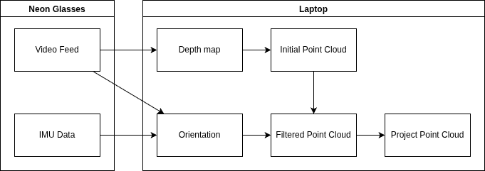
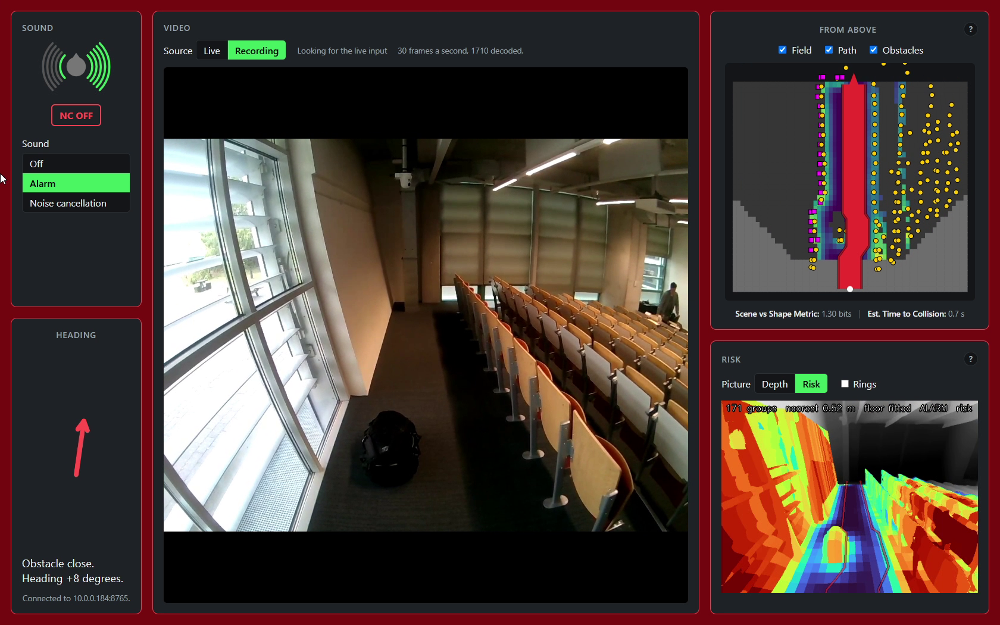
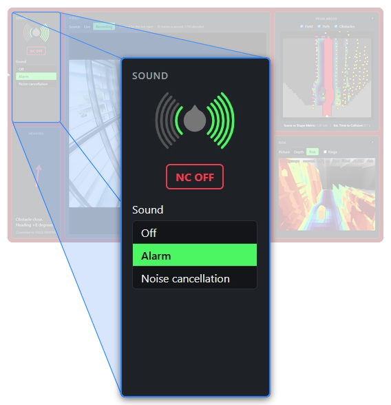
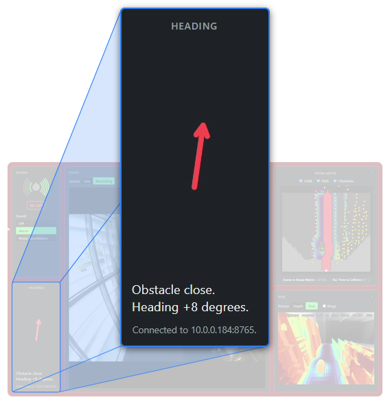
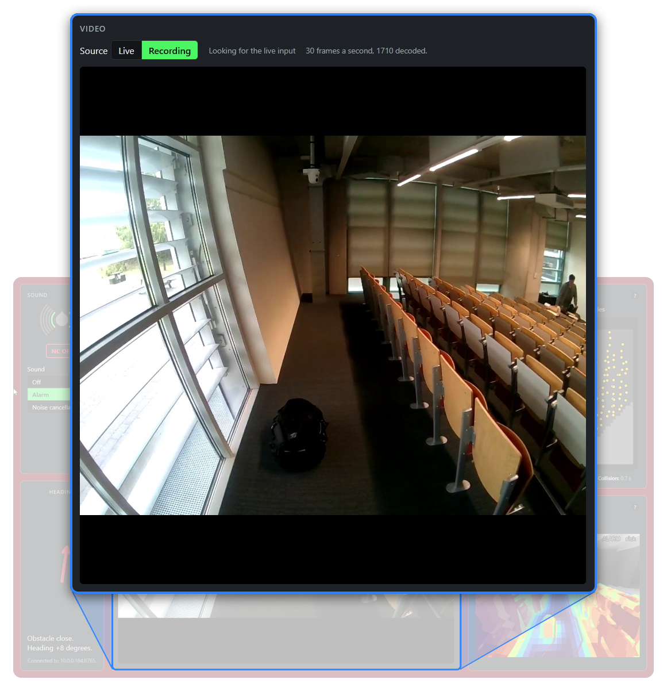
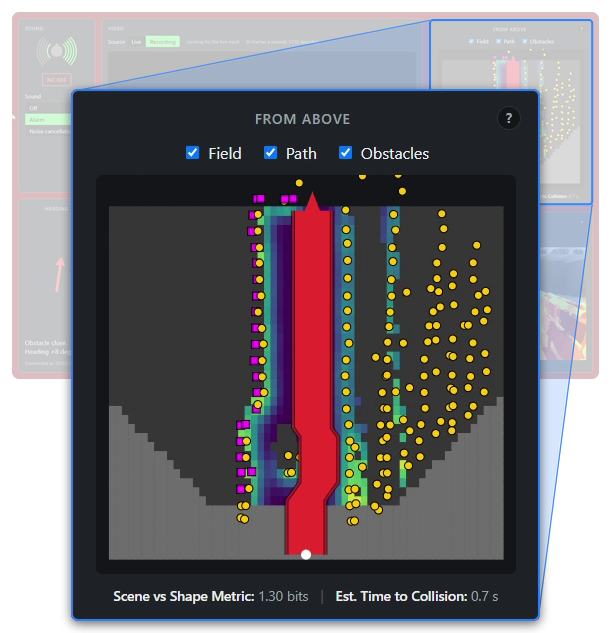
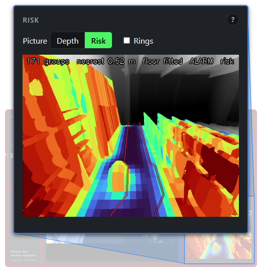

# Abstract

People who walk while looking at a phone, or with headphones on, often notice an obstacle only when they are about to walk into it. We built a walking aid that guides by sound and uses surprise functions to calculate cost. A pair of Neon eye-tracking glasses from Pupil Labs films what the user is seeing, and a laptop estimates the depth of everything in that view with Depth Anything 3. Each 0.25 m cell ahead of the user is assigned a cost from the obstacles in it, how close they are, and how steadily they are measured. The planner then picks the route with the least total surprise and effort over the next few seconds. The user hears a quiet tick toward the side the planner is guiding them to, and an alarm when the gap to something ahead is closing too fast for its size at a signal-to-noise ratio of 1. In development testing on recorded walks, the alarm came late on 3 of 15 approaches, against 8 of 15 for an alarm based on distance alone. The main limit is processing speed, at ~2 to ~3 planned frames a second on our laptop.

**Keywords:** surprise, obstacle avoidance, path planning, monocular depth estimation, eye tracking, audio feedback

# Introduction
The problem of autonomous collision avoidance is one that has plagued autonomous navigation for as long as it has existed, with many proposed solutions with varying levels of success having been attempted already [(Berntorp, 2017)](#references). One trait all of these hold in common is their cost, with reliance on either expensive sensors or extensively trained machine learning models to function, something our team attempts to negate in this project. 

Advancing from an application of surprise theory and Fitts' Law in particular, our proposed solution functions by taking the input of a single camera and formulating a surprise field from its feed. This surprise field corresponds to the amount of risk each section of the area in the camera's view would pose to the user upon entering, where a Lagrangian is then used to formulate a path through this area that would pose the least risk. Based upon this path the user may be advised or directly steered to follow this path.

Central to this project was the desire to have the so called 'user' be as generic as possible, where our solution would work no matter if the user is an autonomous car, a camera mounted on a drone, or a person wearing glasses with an integrated camera. The motivation behind this objective is showing how the application of this technology is not just limited to one specific problem, instead aiding from autonomous navigation to aiding those with impaired vision.

This project was done as part of the course "An introduction to Neuromorphic Human-Computer Interaction" at the Radboud University, taught by Professor Doctor Roel Vertegaal. The work done as part of this project is a continuation upon his work, with his advice having gone a long way to making this project possible.

# Background
## Motivation

A 2017 thesis published at Radboud University concluded that reminding drivers to pay attention to the road has a significant effect on subsequent accidents [(Rijniers, 2017)](#references). Many of these accidents are preventable one-sided accidents, caused by drivers, cyclists, and pedestrians leaving or crossing the road by accident or at the wrong moment. Our leading theory is that wearable computer vision, as found in commercial products like smart glasses, could detect these dangerous situations and direct the user's attention back to the road before an incident occurs.

Alerting the user is only one option. The distractions on the phone can also be muted while the environment is too surprising, similar to how conversations can be muted in cars when the driver needs to focus. The car study referenced in this course applied the same real-time ratio to notification and dialog management in a car interface, based on danger [(Vertegaal, 2026c, pp. 71-72)](#references).

Research on auditory interfaces gives some support for muting as a strategy. Hearing is always available and cannot be turned off, which is why people use headphones to curate their own soundscape. This comes at a cost, because it lowers situational awareness and carries distinct safety risks when used on the move [(Haas, 2023)](#references). Haas also found that when people are asked which sounds in their environment they want to change, they rarely want a sound louder, but often want it muted or reduced, while keeping the information the sound carries. A simple interface with a few discrete states (muted, quieter, unaltered, louder) was preferred over continuous control, although this difference was not statistically significant [(Haas, 2023)](#references). This fits our approach, where distractions are only reduced when the surroundings require it.

The same work also warns about the downside of automation. Systems that alter the soundscape automatically may give the user the illusion of an unaltered environment and an incomplete picture of the situation, and Haas therefore recommends that users keep control over such alterations [(Haas, 2023)](#references). For our system this means that muting should be limited to moments of clear risk, and that the user should always be able to see why something was muted or flagged.

The hardware we use also limits what we can do. The Pupil Labs Neon glasses are monocular, have eye-tracking cameras, and have no other sensing capabilities such as LiDAR. Any sense of distance must therefore be inferred from a single RGB image, which led us to a monocular depth estimation model.

## Surprise

Interactive inference describes human-computer interaction as a form of Bayesian inference, where movement is the result of the sensorimotor system reducing the difference between its predictions and what it observes [(Vertegaal et al., 2025)](#references). In this view, Fitts' Law (the relationship between the distance to a target, its width, and the time needed to reach it) follows from this inference process. Moving towards a target is described as relaxing along a surprise potential. This potential is approximately the negative log probability of the goal distribution and equals a KL divergence. It has the same form as the potential energy of a spring [(Vertegaal et al., 2025; Vertegaal, 2026b, pp. 5-23)](#references): the further the current state is from the goal, relative to the tolerance around it, the higher the surprise.

We apply this idea to the physical environment of the user. An obstacle is a place the user should not end up. The surprise of a point in the environment depends on the signal-to-noise ratio of the gap between the user and that point:
$$U = \tfrac12 \left(\frac{\Delta S}{S}\right)^2$$
where $S$ is the gap and $\Delta S$ is the uncertainty of that gap [(Vertegaal, 2026c, pp. 61-65)](#references). We use this formulation twice in the pipeline:

1. **As a weight for every cell.** The floor plan is divided into cells. For each cell the uncertainty is the *wobble* $N$, and the gap is $S = d - 0.35$, which gives $U=\frac{1}{2}\left( \frac{N}{S} \right)^2$. Here $d$ is the distance between the center of the person and the closest point of the object, and 0.35 m accounts for the forward-most part of the user. This value is the cost of a cell in the planner.
2. **As a collision warning.** When the uncertainty is how much the gap to the nearest obstacle straight ahead has changed recently, $\Delta S$, the equation becomes $U=\frac{1}{2}\left( \frac{\Delta S}{S} \right)^2$, using the ratio from course lecture slides [(Vertegaal, 2026c, p. 65)](#references). This form is used for collision detection: an obstacle that is being closed on quickly is much more surprising than one far away, and the surprise grows quadratically as the gap shrinks.

Both forms express how reliably the user can predict the distance to an obstacle. The exact definitions of $N$ and the cell grid are given in the [Methodology](#methodology).

## Depth Estimation

Depth Anything 3 is a model that "predicts spatially consistent geometry from an arbitrary number of visual inputs, with or without known camera poses" ([source](https://depth-anything-3.github.io/)). We use the metric large variant [(Lin et al., 2026)](#references), which turns a single frame from the glasses into a depth map in meters. This is important for our application, because the surprise equations above require real distances rather than relative depth. The model only outputs depth, so the ground and the height of points have to be derived afterwards from this depth map and the IMU data of the glasses.

## Path Planning

Once every cell of the environment has a surprise value, the next question is which route through them is best. Following the idea that movement is the relaxation along a surprise potential [(Vertegaal et al., 2025)](#references), the safest route is the one that accumulates the least surprise over the next few seconds [(Vertegaal, 2026c, pp. 8, 13, 15, 17)](#references). This is computed as a minimum-cost path through the cost field (Hamiltonian path planning, solved by dynamic programming), which is then reduced to a single heading for the user. The cost of following the resulting path, expressed in bits of surprise, can also be measured afterwards by the user model, which only observes and does not steer anything.

## 3D Reconstruction

[Dense SLAM](https://www.open3d.org/html/tutorial/t_reconstruction_system/dense_slam.html) (**S**imultaneous **L**ocalization **a**nd **M**apping), as implemented in the Open3D library [(Zhou et al., 2018)](#references), builds a 3D reconstruction of the environment from RGB-D input while tracking the movement of the camera through it. Because the surprise of a cell depends on how it changes over previous frames, knowing the movement of the camera is useful in principle. In the current prototype this is an optional component that is disabled by default (see the [Methodology](#methodology)).

## Previous Research

Earlier walking aids warn about obstacles too. CrashAlert puts a depth camera on a tablet, shows a strip of the depth picture along the screen edge, and turns red for obstacles under 2 m. Users dodged and slowed down earlier [(Hincapié-Ramos & Irani, 2013)](#references). BumpAlert uses the phone's speaker, microphones, and rear camera, and vibrates when both detectors find the same object 2 to 4 m ahead [(Tung & Shin, 2018)](#references).

Driving research has used similar ideas. Engström et al. describe driving as acting on predictions [(Engström et al., 2018)](#references), and later simulate a driver who trades progress against caution by minimizing expected free energy [(Engström et al., 2024)](#references).

Adding an attracting goal to repelling obstacles is how artificial potential fields work [(Khatib, 1986)](#references). The closest published match to our search is the path step in Baidu Apollo's planner, which sums smoothness, obstacle, and guidance costs over sideways positions and finds the cheapest route with a dynamic program [(Fan et al., 2018)](#references). Apollo's grid runs along distance and our grid runs along time, and Apollo's costs are chosen by the designers.

# Materials
## Neon smart glasses
A pair of [Pupil Labs Neon smart glasses](https://pupil-labs.com/products/neon) were provided to us by the course coordinator and act as the accessory to provide a real-time stream of images to be analyzed. Included with this is a [Motorola Edge 40 Pro](https://mijnmoto.nl/product/motorola-edge-40-pro/) smartphone, which comes paired with the glasses and allows us to control, review, and analyze the recordings. 
## Neon Companion
The [Neon Companion](https://pupil-labs.com/products/neon/software) phone app runs on the phone the glasses are connected to and is used to read out and record the data from the camera and eye tracker on the glasses. In the prototype, the phone broadcasts the live feed from the glasses over the local network so that this data can be analyzed on a different device. Apart from a video feed, the real-time API also includes information about the glasses' camera calibration and a clock offset used to straighten every frame and sync measurements respectively (see [Appendix D](#d-neon-companion-api)). The live feed moreover includes gaze data from the eye tracker, which is used in the prototype both to optionally silence the alarm when the user looks at detected danger and by the path planner as the preferred direction to walk in.
## Image analysis
Depth Anything 3 is a model that "predicts spatially consistent geometry from an arbitrary number of visual inputs, with or without known camera poses" [Source](https://depth-anything-3.github.io/). It is used to estimate a depth map given an input of a single image [(Lin et al., 2026)](#references).

[RGB-D SLAM](https://www.open3d.org/html/tutorial/t_reconstruction_system/dense_slam.html) is a (dense) implementation of **S**imultaneous **L**ocalization **a**nd **M**apping included in the Open3D library [(Zhou et al., 2018)](#references). The depth maps generated by Depth Anything 3 can optionally be fed into SLAM (disabled by default), which builds a 3D reconstruction of the environment and the movement of the camera through it.
# Methodology

## System Overview
The smart glasses stream video, inertial measurement unit (IMU) readings, and gaze data to the Neon Companion app on a paired phone. The app forwards this data over the local Wi-Fi network to the server. A background process decodes the incoming video at 30 frames per second, while the planning worker always takes the newest available frame rather than building up a queue. If processing falls behind, older frames are discarded so that the system continues to work with a recent view of the environment.

Before analysis, the selected frame is corrected using the glasses camera calibration. The server associates it with the closest IMU reading, provided that reading is within 50 ms of the frame's capture time. Without a sufficiently close reading, the frame is still used, and the server assumes the head is level. Depth Anything 3's metric large model then estimates a depth map in meters. The model supplies depth, not a height map, so the server uses the depth and IMU data to reconstruct 3D points and estimate the floor. It filters the points to retain those between ankle and head height, then projects them onto a 2D floor grid of 0.25 m cells. Each cell is characterized by its distance from the walker and by the small changes of that distance across recent frames, which represents how much the measured gap varies over time. Camera position can also be estimated using odometry or dense SLAM, but both options are disabled by default (see [Appendix G](#g-camera-position)).

The planner assigns costs to the cells and uses dynamic programming to find a low-cost path over the next few seconds. It converts that path into a heading and determines whether an alarm should sound. Gaze data can optionally silence the alarm when the user looks toward a detected hazard. Separately, the user model measures the avoidance cost of the resulting movement in bits. It is an evaluation component: it observes and scores the path, but does not steer the planner.

For evaluation and documentation, the server sends the plan with the heading, alarm state, and associated measurements to a webpage over HTTPS on the local network. The webpage decodes the glasses video stream and overlays the plan and other information for inspection. It is not intended to serve as the user-facing interface.

NOTE: Dense SLAM or Odometry-based camera positions are optional (see [Limitations](#limitations))

## Point Cloud Generation
Point cloud generation refers to the repeated creation of a 3D map of points that are most crucial for navigation. It is generated primarily by analyzing the video feed from the glasses, but could alternatively simply be obtained from LiDAR sensors on select smartphones and smart glasses. This would nullify the need for the additional computation discussed in this section. The general flow for point cloud generation is given in below image.

The smart glasses are equipped with a wide-angle camera, which records a barrel distorted (fisheye) image. The first step is to straighten this image using the camera's calibration, to undo the effects of distortion (see [Appendix C](#c-point-cloud-details)). 

This image is then piped into Depth Anything 3's metric model to determine a depth (distance from camera) for every point. But because this model treats each image as if it were captured on a 300 pixel focal length camera [(Lin et al., 2026)](#references), the camera's real focal must first be scaled from the resolution at which the model runs:
$$
z = z_{raw}\cdot \frac{\bar{f}}{300} \qquad \bar{f}=\frac{f_{x}+f_{y}}{2}
$$
The scaled (actual) depth $z$ and depth returned by the model $z_{raw}$ are both in meters. The horizontal and vertical focal length values $f_{x}$ and $f_{y}$, which correspond to the depth map produced by the model, are measured in pixels. The average focal length is signified with $\bar{f}$. Every pixel is then sent back along its ray as far as the estimated depth specifies, to generate a 3D image of the visible environment.

To help orient and interpret the meaning of these points, the position of the floor is estimated for each frame. The floor is defined as a plane:
$$
\hat n \cdot \mathbf p + h = 0
$$
With $\hat{n}$ being the unit normal pointing up and $h$ the camera height, which is determined by incorporating data from the on-board Inertial Measurement Unit (see [Appendix A](#a-from-imu-to-camera-up)). After this, the distance from the floor of every point $e_{i}$ is computed in meters using:
$$e_i = \hat n \cdot \mathbf p_i + h$$
Every point that is either too high or too low to collide with is filtered out. In the prototype, this leaves points $\{e_{i} \mid 0.2 < e_{i} < 2.0\}$.

Finally, the filtered point cloud is projected onto a 2D top-down representation of the environment by using the IMU (Inertial Measurement Unit) data to determine each point's lateral and forward position. 

## Point Cloud Cost
After the point cloud has been generated, each group of points gets a 'price' assigned to it. This price is effectively the surprise the user will experience when encountering this group of points, and is used by the planning algorithm to compute the optimal path using least surprise.

The 2D top-down map of points is first chopped into a grid of $0.25\text{ m}$ squares ('cells'), for a grid that extends $6\text{ m}$ in front of the walker and $3\text{ m}$ to either side. Cells with fewer than 2 points are filtered out as they are likely the result of depth noise. For each cell, we select the single point that is closest to the walker, raise it to the height of the highest point in the cell and delete all other points. If the height of this point $e \ge 1.5\text{ m}$, the entire cell is marked as a 'wall'. Every frame is analyzed at face value, so the entire grid moves with the walker.

Each point is given a surprise value based solely on the gap and wobble of that point. The gap $S$ is defined as the difference between the distance from the walker to the cell's closest point $d$ and the edge of the walker's circular footprint with radius $r$:
$$
S=d-r \qquad r=0.35 \text{ m}
$$
Wobble $N$ is a measure of how much the gap for a given cell has changed over the last few frames. For this, it evaluates values of $S$ over the last $1 \text{ s}$, computes the standard deviation given $\ge 3$ samples, and sets the lower bound of the result to be $0.01 \text{ m}$. In our tests on the glasses ~40 % of cells had enough samples and the rest used this lower bound (see [From Above](#panel-from-above)). The value of $N$ is tripled for points $p$ in that are walls $W$ to encourage the planner to steer around them:
$$
N=max(SD\{S_{t} \mid t \le 1 \text{ s}\}, 0.01) 
\qquad
N = 
     \begin{cases}
       3N & \text{if } p \in W \\
       N &\text{otherwise} \\ 
     \end{cases}
$$
Each obstacle point is assigned a measure of (collision) surprise $U$, which is quantified in natural-log units (nats), which become bits when divided by $\ln 2$ [(Vertegaal & Rauterberg, 2026, Eq. 2)](#references). Surprise is defined as being half of the squared noise-to-signal ratio:
$$
U_{collision} = \frac{1}{2} \left( \frac{N}{S} \right)^2
$$

## Planning
To find the optimal path to guide the user in, the planner first computes the cost of the paths for all reachable states. This is represented as a field of time/position pairs with a temporal interval $\Delta t = 0.1\text{ s}$ and a spatial interval of $0.1 \text{ m}$ for each lateral position over a horizon of a few seconds. The walker is assumed to be moving at some constant speed $v = 1.4 \text{ m/s}$, such that at step $k$, they would be $v\cdot k\cdot \Delta t$ meters further ahead. Because of this, obstacle points are predicted to always come closer for higher values of $k$. 

At each step and position in the field, two terms are added together to determine the surprise of that entry. The first is collision surprise, already given as the cost of the point in the point cloud. The second is contact surprise, which is the cost of the walker's body probably touching the obstacle. Let $d$ be the distance from a candidate walker's center to an obstacle point and $r$ be the circular footprint of the walker. The clearance $S$ then becomes:
$$
S_{b} = d - r \qquad r=0.30 \text{ m}
$$
The body's positional uncertainty is quantified as the standard deviation $\sigma$ of the assumed normally distributed clearance $S_{b}$. This is a combination of two independent sources of uncertainty: noise $N$ and assumed sway $s$:
$$
\sigma = \sqrt{ N^2 + s^2 } \qquad s=0.10 \text{ m}
$$
The chance of walking past an obstacle without contacting it is the standard normal cumulative $\Phi\left( \frac{S_{b}}{\sigma} \right)$. The negative logarithm of this number is taken to convert the probability into surprise [(Vertegaal, 2026a, p. 43)](#references), by mapping a high probability of passing to low surprise and vice versa. This surprise is divided by time-to-impact $\tau_{b}$, which is the estimated time required for the walker's body with radius $r$ to move past the obstacle at a constant speed $v$.
$$
\tau_{b}=\frac{2r}{v}=\frac{2\cdot 0.30}{1.4}\approx 0.43\text{ s}
$$
This is done to convert the scalar surprise into a rate per second, so it can be integrated consistently over the planner's time steps. Contact surprise is defined as:
$$
U_{contact}=\frac{-\ln \Phi\left( \frac{S_{b}}{\sigma} \right)}{\tau_{b}}
$$
For each time/position pair in the field, the planner combines the two surprises to determine the surprise of the single 'worst' point in that cell:
$$
U_{point} = U_{collision} + U_{contact}
$$
Next, a goal term is used by the planner to incorporate the eye tracking data (gaze) to steer the walker into the direction they're looking in the event a tie between equally costly paths is reached. Each candidate position in the final row $x$ is used in conjunction with the desired position in the final row $x_{goal}$  to allow the user to 'choose' a preferred path. The difference between these two is divided by the tolerance $T$, which signifies the maximum acceptable lateral distance from the gaze to the goal. If the walker's gaze falls outside of $T$, the tie is broken using random chance:
$$
U_{goal}=\frac{1}{2} \left( \frac{x-x_{goal}}{T} \right)^2 \qquad T = 1.5 \text{ m}
$$
In order to prevent the planner from outputting a completely different path due to the slightest bit of noise, a previous plan prior is used to pull the arrow towards where it was last frame. A penalty $U_{prior}$ is added to every candidate lateral position $x$ in the field, based on how much it deviates from where the previous plan predicted the walker would be now $x_{prev}$ given the time since that plan $\Delta T$:
$$
U_{prior} = \frac{1}{2}\cdot \frac{(x-x_{prev})^2}{0.25^2 + 0.05 \cdot \Delta T}
$$
This prior is added to the field. A dynamic program then chooses the cheapest sideways route through the field over time. The cost of each step is that of the entry in the field at the position reached $[k,c]$, added to the squared cost of moving sideways $v_{x}$. A weight variable $w$ is introduced to help encourage the planner to avoid overly diagonal paths.
$$
C_{step} = \left( F[k,c] + \frac{1}{2} \cdot w\cdot v_{x}^2 \right)\cdot \Delta t
\qquad
w = 6.5
$$
The planner uses back-pointers in a dynamic programming algorithm to compute and store the cheapest reachable state for an increasing time interval $\Delta T=0.1\text{ s}$ starting at the walker, until it reaches the temporal horizon at $t=3.8 \text{ s}$. The planner then reports the cell with the cheapest final cost and follows its back-pointers to reconstruct the path. This value is converted from nats to bits before being read by the user model.
$$
C_{bits} = \frac{C_{nats}}{\ln 2}
$$
## Collision Detection
The prototype continuously scans for potential collisions using the data from the point cloud and alarms the user when it detects a dangerous situation. This happens independently from route planning so that it is reliable when the path is wrong. 

Corridors are tricky, as their narrowness generates high levels of surprise even though the walker is experiencing low levels of danger. A corridor is a line of cells ahead of the walker on either side, spaced in such a way that continuing forward could cause a collision. To account for this, the alarm only warns the user if the obstacles are both in front of the walker and are not spaced sufficiently for the walker to fit between: 
$$
y>0 \, \land |x| \le 0.30 \text{ m}
$$

- separate from plan on purpose: reads obstacles, never the path -> still fires when plan is wrong
- **corridor:** cells strictly ahead, within 0.30 m (body half-width) either side. Furniture being walked past isn't in it, neither are sides of a doorway you fit through
  - NOTE: 0.30 m, not the 0.35 m footprint: at 0.35 + 0.15 a 0.9 m doorway alarmed on 93 % of frames, at 0.30 it's 36 %
- **gap ratio:** how fast the gap to the nearest thing ahead is closing, compared with how big that gap still is. Nearest corridor cell's gap $S$, and how much it changed over the last 3 s, $\Delta S$ (standard deviation, at least 3 frames). Slides use 1 s [(Vertegaal, 2026c, p. 65)](#references), too few frames at ~3 a second. No walking speed assumed, so standing still near something doesn't count
- **alarm:** slides' signal-to-noise of 1 [(Vertegaal, 2026c, p. 70)](#references), as $c\,\Delta S \ge S - m$. $m = 0.2$ m = safety line out from the footprint, a margin specific to this use case. $c = 1 + d/(kT) = 1.63$ brings gap forward over our ~0.65 s delay $d$ (Appendix E), so with no delay $c = 1$ = slides' rule exactly. Once up, holds 0.5 s on frame timestamps so it doesn't flicker (classroom walk: 108 state changes -> 66)
- **old rule (distance), still a switch:** $\tau = S_{\min} / 1.4 < 0.7$ s (0.98 m). Assumes walking speed, so it rang while standing still: on replays 46 % of slow frames against 35 %
- **avoidance surprise (the form from Background):** sent with every plan, in bits:

  $$U_{\text{avoid}} = \tfrac12 \left(\frac{c\,\Delta S}{S - m}\right)^2 \Big/ \ln 2$$

  - 0 with empty corridor, 0.72 bits at the alarm point (ratio of 1). Page's path goes from normal color to full red at 0.72 bits, same frame the alarm goes up. Page's time to collision = gap over the closing speed the spread implies, no speed assumed. **Only the alarm and the page read this form.** Planner's field never does
- **gaze silencing (switch, off by default):** a beep about a chair you just looked at says nothing new
  - looked = any gaze sample within 0.1 s of the frame lands within 2° of the object's outline in the picture (Neon accuracy 1.8°). Look remembered 2 s, slid toward walker at 1.4 m/s (what counts as "the object": Appendix E)
  - looked + switch on -> alarm still red on page, but not heard. Never changes path or alarm itself. No gaze -> counts as not looked, so fails to "heard"

## Overlay
The stereo cue is an automatic alarm that plays at different levels in both ears of the walker, working both to warn them and to steering them towards a desired direction. Although this cue is part of the overlay, the values are determined on the server. The gain of either ear is based on the heading angle $\theta$, which is the direction of the arrow relative to walking straight ahead:
$$
\text{direction} = 
\begin{cases}
	 \text{left} & \theta < 0 \\ 
	 \text{straight} & \theta = 0 \\
     \text{right} & \theta > 0 \\
\end{cases}
$$
The volume is increased on the side the turn goes to, so a path curving to the left would increase gain on the left ear whilst lowering it on the right. If the desired path is straight ahead, neither ear's volume is lowered. Gain $g$ is computed with a goal tolerance $\sigma_{\theta}$ of $1.5 \text{ m}$ over a $4\text{ m}$ distance:
$$
g=e^{-\frac{1}{2}\left( \frac{\theta}{\sigma_{\theta}} \right)}
\qquad
\sigma_{\theta}=\arctan\left( \frac{1.5}{4} \right) \approx 20.6^\circ
$$
Using this formula, the far side ear retains roughly at least $22.5\%$ volume when active. When danger is detected, the volume on the side of the danger drops to $10\%$, which is done for both visualized in the top left corner of the overlay (see [Panel sound](#panel-sound)).

## Hardware and Data Capture
The glasses are equipped with a forward-facing camera that films 1600 × 1200 pixels at 30 frames a second, a motion sensor called an IMU (inertial measurement unit) read at ~110 Hz, and eye cameras that report gaze at 200 Hz. All processing runs on a laptop with a Quadro T2000 GPU (4 GB), which also serves the web page.

We recorded walks in three ways, each suited to a different kind of testing:

- **Companion Recording:** The Companion app on the phone records everything itself, meaning the video, IMU, gaze, and camera calibration. These recordings are our raw data archive, kept for later tests and demos such as the presentation demo.
- **Stream Capture:** The server saves exactly what the glasses send over Wi-Fi, the compressed video packets along with IMU, gaze, and calibration, without decoding anything while recording. Replaying a capture tests everything the server does on a live walk, from decoding to timing and matching IMU readings to frames. It replays lost packets, but not the network delay.
- **Frame Log:** The server saves the depth frames coming out of the depth model (`--record-to`). Replaying a log skips straight to building the point cloud and planning, which makes testing the math after the depth model much faster. It cannot test anything before the depth model.

A replayed recording or capture goes through the same processing as a live user, as if the glasses were on, so frame rate and delays are real. Network delay is not a factor. The demos and the measurements in this report ran this way.

In total we recorded ~25 minutes of walking, all with the glasses and all indoors. The table below lists a sample of those recordings, the ones used in this report.

| Recording          | Date       | Length | Used For                                    |
|--------------------|------------|--------|---------------------------------------------|
| Walking Demo       | 2026-10-09 | 148 s  | Demo video, overview figure, measurements   |
| Attention Demo     | 2026-10-14 | 44 s   | Measurements, depth jitter, camera position |
| Tiered Room Stairs | 2026-10-08 | 121 s  | Stairs scenario                             |

The Walking Demo goes through a lecture room past rows of chairs and a bag in the aisle. The Attention Demo follows a script: stare at a chair, walk past it once looking at it and once not, go up the stairs, and walk toward a wall. The Tiered Room Stairs recording walks up and down the stairs of a tiered lecture room.

# System Measurements

At the end of the development process of the product, the product needed to be presented to our peers. For this presentation a demonstration of the product was made, this demonstration had next to a live demonstration also a back-up video in which a user from the development team used the glasses while walking through a lecture room at Radboud university. The image below shows a frame from this back-up video, with panels showing what the system measures and what it does with those measurements. Only the sound reaches the user, the other panels are there for development.

The page prints these values for the frame in the image, ~57 s into the walk:

| Heading | Time to collision | Nearest | Groups | Scene vs Shape |
|---------|-------------------|---------|--------|----------------|
| +8°     | 0.7 s             | 0.52 m  | 171    | 1.30 bits      |

The tables below come from replaying two recorded walks on the server with depth at 336 px: the Walking Demo in the image (~2.5 minutes) and the scripted Attention Demo in a tiered classroom (~45 s, up to a chair, past it, up the stairs, and toward a wall). The numbers are from one run of each, not a benchmark.

## Panel: Sound

The panel at the top left is the output panel. This is the visual demonstration of what the product feeds back to the user. The top part shows the left and right speaker of the music device of the user. When encountering an obstacle with high risk it will start emitting a beeping noise from that specific side. The five bars on each side show how loud that ear is. On an alarm the ear on the side of the obstacle goes quiet, which is why the left side is gray in the image. There are also options to turn off the sound, or to switch between the **Alarm** and **Noise Cancellation** modes. The **NC** label shows that noise cancellation would be turned off while the alarm sounds.

|                              | Demo               | Attention          |
|------------------------------|--------------------|--------------------|
| Alarm frames                 | 97 of 315 (30.8 %) | 56 of 112 (50.0 %) |
| Alarm changes per minute     | 16.7               | 25.0               |
| Quieter ear volume, alarm    | 10 %               | 10 %               |
| Quieter ear volume, no alarm | 84.1 %             | 84.1 %             |

In our tests the alarm was up on ~30 to ~50 % of frames, in rooms full of chairs and desks. Volumes are medians. Without an alarm the two ears usually stayed close in volume, so the steering sound is mostly subtle.

## Panel: Heading

The panel at the bottom left is the direction the user should walk towards to follow the safe path. This is not part of the output the user sees but the direction is concluded from the calculated path. The direction heading is used to steer the user by sound: the ear away from the heading becomes quieter. It also gives an entry point for different implementations to take input from, to guide the user along the safe path in other ways.

|                | Demo   | Attention |
|----------------|--------|-----------|
| Median heading | 12.1°  | 16.0°     |
| At limit       | 10.2 % | 6.2 %     |
| Full swings    | 0      | 0         |

Headings are sizes, left or right of straight ahead. The limit is ~36°, a full sidestep at walking speed. A full swing is the heading jumping from the limit on one side to the limit on the other in one frame, and we saw none in our tests.

## Panel: Video

The central panel is the field of view from the user, recorded by the camera on the Neon glasses. This video shows the lecture room environment. The video shows the rows of chairs on the right, a wall with glass on the left, and the path between those. In the path is a big black bag placed that functions as an obstacle for the user. This video feed is the input for the product to apply all the earlier mentioned functionalities on.

| Step        | Demo median | Demo 95th percentile | Attention median | Attention 95th percentile |
|-------------|-------------|----------------------|------------------|---------------------------|
| Depth       | 411 ms      | 720 ms               | 340 ms           | 480 ms                    |
| Point cloud | 83.6 ms     | 410 ms               | 58.3 ms          | 145 ms                    |
| Planner     | 141 ms      | 350 ms               | 99.5 ms          | 157 ms                    |
| **Total**   | **646 ms**  | **1535 ms**          | **514 ms**       | **688 ms**                |

In our tests the system planned ~2 to ~3 of the camera's 30 frames a second, and 95 % of frames finished within ~0.7 to ~1.5 s, with 5 % taking longer. We report that figure because the slow frames are the risky ones: at 1.4 m/s a walker covers ~1 to ~2 m in that time, which is why the alarm makes up for the delay (see Collision Detection). The steps don't add up to the total because each one is measured separately.

## Panel: From Above

The top right panel shows the planner's view from above. The yellow dots are obstacles and the pink squares are walls, one for each 0.25 m cell that has points in it. The panel also shows colored areas below and around the dots, corresponding to the cost of walking through each spot. The cost goes from dark blue to green to yellow in order of increasing risk, and the gray areas are floor. Finally there is a big red line with an arrow to show the safe path for the user, this path is the cheapest route through these costs and is the source for the [Heading](#panel-heading) panel and the steering sound.

|                 | Demo                      | Attention                |
|-----------------|---------------------------|--------------------------|
| Cells per frame | 141                       | 111.5                    |
| Measured $N$    | 15,704 of 41,944 (37.4 %) | 5,633 of 12,730 (44.2 %) |
| $N$, median     | 0.033 m                   | 0.041 m                  |

$N$ is how much a cell's gap changed over the last 1 s, and it needs 3 samples in that window. At ~2 to ~3 planned frames a second ~40 % of cells had enough in our tests, and the rest used the 0.01 m lower bound. The grid moves with the walker, so $N$ partly compares different spots.

## Panel: Risk

The bottom right panel is the depth image colored with the same costs as the [From Above](#panel-from-above) panel, from blue for low risk to red for high risk. The panel shows the high risk, dark red, areas such as the chairs on the right and the wall on the left. It determines the floor as completely safe, seen by the dark blue color, except for the black bag placed. The bag has a clear yellow which indicates it has some risk of collision. Next to the bag is the safe path shown with two red lines. These are the same path as in the [From Above](#panel-from-above) panel.

|               | Demo   | Attention |
|---------------|--------|-----------|
| Camera height | 1.62 m | 1.47 m    |

|              | Median          | Worst tenth     |
|--------------|-----------------|-----------------|
| Depth jitter | 1.3 % (0.027 m) | 5.2 % (0.138 m) |

Camera height is measured above the fitted floor, with nothing to check it against. Depth jitter is how much the depth model's depth for one 3D point changes between frames ~0.2 s apart, measured on the Attention Demo. The floor level was right on 48 of 49 frames we labeled by hand.

# Scenarios

While no formal experiment was done with the prototype, we describe several scenarios in which the technology could be used. Each of these were chosen to reflect a situation a final version of the prototype might be used in, focusing on collision avoidance, navigation, and situational awareness. These range in a steadily increasing grade of difficulty, going from straight line obstacle avoidance to full room navigation.

| Scenario                                                          | Desired Response (Prototype)                                                                                                                                  | Expectation | Additional Context                                                                                                                                                                                                                |
|-------------------------------------------------------------------|---------------------------------------------------------------------------------------------------------------------------------------------------------------|-------------|-----------------------------------------------------------------------------------------------------------------------------------------------------------------------------------------------------------------------------------|
| Walking straight down a hallway with an object in the way.        | The user continues listening to music while the system lowers the volume in the ear nearest the obstacle and provides an alert, helping them steer around it. | V           | Shown in the demo video, with a bag in the aisle of a lecture room.                                                                                                                                                               |
| An approaching pedestrian is on a collision course to the user.   | The user receives an immediate alert so they can react to the approaching pedestrian.                                                                         | V           | In its current form the system does detect an approaching pedestrian, because the alarm reacts to how fast the gap closes. The limit is processing speed: a fast approach closes much of the gap before the user hears the alarm. |
| An object is on a collision course to the user.                   | The user has their noise cancellation negated temporarily until the alarm clears.                                                                             | V           | In the demo video the **NC OFF** label appears while the alarm is active.                                                                                                                                                         |
| A visually impaired person moves throughout a room without sight. | The system uses directional audio feedback to indicate the obstacles and guide the user toward a safer path through the room.                                 | V           | Informally tested during development by short sessions navigating with closed eyes and audio cues.                                                                                                                                |
| A user moves at high speed towards an obstacle.                   | The system uses directional audio feedback to indicate the obstacle and guide the user around it                                                              | X           | The system doesn't plot far enough in advance to avoid the object.                                                                                                                                                                |
| Walking towards a pair of stairs next to chairs in the cinema.    | The system guides the user along a path over the stairs, avoiding the chairs                                                                                  | V           | Recorded walking up and down the stairs of a tiered lecture room.                                                                                                                                                                 |
| Walking along the beach, the user attempts to walk into the water | The system guides the user away from the water, back onto the less risky sand                                                                                 | X           | As designed, the system is not expected to distinguish between surface types, making calm water just as safe of a surface as a solid wooden floor. This is untested.                                                              |

# Discussion

## Limitations

Due to the available timeframe and resources several limitations had to be set for this project, these focusing around code implementation and the explored options for data gathering. Apart from this another limitation is also present in the current implementation, which relies on a separate server to run the calculations and stream the directions back to the user, imposing a limit due to network delay and connection requirement. Our delay figures start when a frame reaches the server, so they leave out the ~130 ms from capture to arrival on a live run and the time for the sound to play, which we did not measure on the glasses.

A major factor apart from this is the usage of large language models for the implementation of the prototypes, where the limited amount of time required the usage of such tools to translate our plan, formulas, and approach into a functional product. While this allowed us to make the implementation feasible, its cost is also significant, as several bugs and structural mistakes were made by the LLM. Due to this the continued development of the product should involve the replacement and redesign of this prototype with a more solid implementation.

To expand on this, another part requiring optimization would be the usage of so called magic numbers in the prototype, which are numbers our team found as working well enough for demonstrations, but might be far from the optimal values. The benefits of finding these optimal points would be debatable though, as the cost for doing so would be relatively expensive for perhaps limited improvements to the final product.

Shifting to the hardware, a defining factor of our project and approach is the usage of only the camera as an information source, which while cheap and almost universally available, is not the most optimal sensor for this project. Applications of Lidar might have improved accuracy, but due to cost of Lidar enabled devices this avenue could not be explored, leaving the less accurate camera as the only way of generating the point cloud.

The course coordinator advised us to use SLAM, so we built Open3D's dense SLAM and tested it on a recorded walk. Run offline with depth for all 30 frames a second, it tracked the walk to ~0.2 m. Our server's depth model only delivers ~3 frames a second, and at that rate the error rose to ~1 m. As a workaround we added frame-to-frame odometry, which stayed at ~0.2 m at the rate the server can deliver. Both are available through a flag and are off by default. With a position the cells stay fixed to the world, which changes the input to the planner, but in our tests we could not show that the plans got better, and the plan sat at its heading limit more often (~20 to ~40 % of frames, against ~5 %). With a faster server we expect dense SLAM to hold up live.

## Next Steps

Based upon the research and resulting prototype, several avenues for further applications and improvements open up. These are divided between new applications of the technology and ways to improve performance. Last are some experiments for more specific use cases, investigating how the technology holds up in environments less suited to what it was originally designed for.

Beginning with the possible improvements, a major focus of any next step would be the incorporation of a longer stage planning strategy, allowing the technology to look further ahead than a couple of meters. The benefits of this would be that a user may now be guided towards an objective while remaining clear of high risk areas, where a location would be set in advance and the relative position to this location be measured using gps. During operation a slight increase of risk may then be applied to areas leading away from the target. These should not be high enough to divert a user into a high risk area to reach their objective, but would be sufficient to keep them from going in circles without arriving anywhere.

Continuing on the application of gps, apart from including directions, it may be used to automatically designate certain areas as higher risk than others, serving as another input for the planning part of the program. This would assign a higher risk to areas known to be dangerous beforehand, such as highways or lakes, alongside adjusting a path to make use of a designated crossing site for roads. A limitation in this extension could show up in the accuracy of the gps, which depending on device might not be accurate enough to distinguish between a sidewalk and the bicycle lane a meter next to it.

Apart from this, another avenue of providing more information about the risk of surrounding areas could be gained from the application of bluetooth communication between user devices, which would notify each other of their respective locations and take these into account when assigning risk. This should allow devices to keep from collision even if the other device is not in the camera field of view.

Continuing with further experiments, one that needs to be included for certain is the performance on high speeds, as the faster movements might interfere with the point cloud formation. Besides this another issue would be the time required for processing, as a collision might have already taken place by the time the user is notified of the risk to do so, or the advised path would be too short as the user travels its entirety before the next section could be calculated.

Last, while we acknowledge that our current prototype is very generic in its applications and could be used in many of them with little adjustment, a few areas exist which we would designate as the most logical next steps, these in part decided due to the benefits it might bring to society. First would of course be those with impaired sight, this technology serving a similar role as a guide dog to those unable to see their surroundings themselves, allowing them freedom without the many expenses needed for conventional solutions. Besides this the potential for autonomous vehicles exists as well, with cars and drones relying upon this technology being capable of navigating unseen areas without a human operator.

# Conclusion

We built a walking aid that guides by sound and uses the surprise as its cost function. A pair of Neon glasses films the view ahead, a laptop estimates the depth of everything in that view, and each 0.25 m cell ahead of the user is assigned a cost from the obstacles in it and proximity. The planner then picks the route with the least total surprise and effort over the next few seconds. The user hears this guidance as a quiet tick toward the side to walk to and an alarm when the gap to something ahead is closing too fast for its size, indicating a potential collision. The whole chain runs live end-to-end, from the camera to the headphones, but can also be tested and improved quickly by recording specific scenarios.

To accommodate a user that is walking, rather than the driving examples the collision term was built on [(Vertegaal, 2026c, p. 65)](#references), we added a contact term to supplement the collision term, leaving the surprise as the primary factor but giving us a way to adjust for obstacles that are measured steadily. A stationary obstacle that is measured steadily has little noise, so under the surprise term alone walking straight into it cost almost nothing. A prior on the previous plan keeps the direction from flipping between frames. Without it the cues to the user were too rapid and chaotic to be useful, with early tests showing rapid swings in guidance, sometimes more than 100 times per minute. 

The alarm itself follows the surprise of a closing gap from the car-following example [(Vertegaal, 2026c, p. 65)](#references), half the squared ratio of the gap's change to the gap itself. It raises when the gap's change over the last few seconds is as large as the gap remaining, which corresponds to a signal-to-noise ratio of 1, adjusted for our processing delay, so it needs no assumed walking speed. However, the terms and resulting estimate can still be refined further, as development testing revealed that it occurred late on roughly 1 in 5 instances of approaching collisions. This was still a notable improvement when compared to the distance-only calculations, which occurred late more than 1 in 2 instances.

The most pressing limitations for this implementation are in the inputs and the processing speed. The laptop used for planning could process around 2 to 3 frames per second, so the noise in the surprise term is measured on only ~40 % of cells, and a frame takes ~0.5 to ~0.7 s from arrival to plan. Initial measurements were performed with team members performing loosely-scripted scenarios, which were recorded to be used for reproducible repeated measurements and testing. The proposed next steps are a faster depth estimate, and then a study of people walking with the sound as their only guide.

# References
- Berntorp, K. (2017). Path planning and integrated collision avoidance for autonomous vehicles. In *2017 American Control Conference (ACC)* (pp. 4023-4028). https://doi.org/10.23919/ACC.2017.7963572
- Engström, J., Bärgman, J., Nilsson, D., Seppelt, B., Markkula, G., Piccinini, G. F., & Victor, T. (2018). Great expectations: A predictive processing account of automobile driving. *Theoretical Issues in Ergonomics Science, 19*(2), 156-194. https://doi.org/10.1080/1463922X.2017.1306148
- Engström, J., Wei, R., McDonald, A. D., Garcia, A., O'Kelly, M., & Johnson, L. (2024). Resolving uncertainty on the fly: Modeling adaptive driving behavior as active inference. *Frontiers in Neurorobotics, 18*, 1341750. https://doi.org/10.3389/fnbot.2024.1341750
- Fan, H., Zhu, F., Liu, C., Zhang, L., Zhuang, L., Li, D., Zhu, W., Hu, J., Li, H., & Kong, Q. (2018). *Baidu Apollo EM motion planner*. arXiv:1807.08048. https://arxiv.org/abs/1807.08048
- Haas, G. (2023). *Towards Auditory Interaction: An Analysis of Computer-Based Auditory Interfaces in Three Settings* [Doctoral dissertation, Ulm University]. https://oparu.uni-ulm.de/server/api/core/bitstreams/c45354b6-409b-4444-81e5-d55b99acf3f1/content
- Hincapié-Ramos, J. D., & Irani, P. (2013). CrashAlert: Enhancing peripheral alertness for eyes-busy mobile interaction while walking. In *Proceedings of the SIGCHI Conference on Human Factors in Computing Systems (CHI '13)* (pp. 3385-3388). ACM. https://doi.org/10.1145/2470654.2466463
- Khatib, O. (1986). Real-time obstacle avoidance for manipulators and mobile robots. *The International Journal of Robotics Research, 5*(1), 90-98. https://doi.org/10.1177/027836498600500106
- Lin, H., Chen, S., Liew, J. H., Chen, D. Y., Li, Z., Zhao, Y., Peng, S., Guo, H., Zhou, X., Shi, G., Feng, J., & Kang, B. (2026). Depth Anything 3: Recovering the visual space from any views. In *International Conference on Learning Representations (ICLR 2026)*. https://arxiv.org/abs/2511.10647
- Pupil Labs. (n.d.). *IMU transformations*. https://docs.pupil-labs.com/alpha-lab/imu-transformations/
- Rijniers, R. (2017). *Ogen op de weg Een vermindering van het smartphonegebruik op de N36 middels een gedragsinterventie langs de weg* [Radboud Universiteit]. https://theses.ubn.ru.nl/items/c8935b8d-8583-455a-97e4-90905e7adb13/full
- Schönberger, J. L., & Frahm, J.-M. (2016). Structure-from-motion revisited. In *Proceedings of the IEEE Conference on Computer Vision and Pattern Recognition (CVPR)* (pp. 4104-4113). https://doi.org/10.1109/CVPR.2016.445
- Tung, Y.-C., & Shin, K. G. (2018). Use of phone sensors to enhance distracted pedestrians' safety. *IEEE Transactions on Mobile Computing, 17*(6), 1469-1482. https://doi.org/10.1109/TMC.2017.2764909
- Vertegaal, R. (2026a). *College 3. Bayes theorem, relative entropy and interactive inference* [Lecture slides]. Radboud University.
- Vertegaal, R. (2026b). *College 4. Interactive inference* [Lecture slides]. Radboud University.
- Vertegaal, R. (2026c). *College 5. Interactive inference (2): Models and metrics* [Lecture slides]. Radboud University.
- Vertegaal, R., Merritt, T., Greenberg, S., Tarun, A. P., Li, Z., & Fountas, Z. (2025). *Interactive Inference: A Neuromorphic Theory of Human-Computer Interaction*. https://arxiv.org/abs/2502.05935
- Vertegaal, R., & Rauterberg, M. (2026). *Stationary interaction: A variational account of user models as generative energy potentials*. Manuscript under review at the International Journal of Human-Computer Studies.
- Zhou, Q.-Y., Park, J., & Koltun, V. (2018). *Open3D: A modern library for 3D data processing*. arXiv:1801.09847. https://arxiv.org/abs/1801.09847

# Appendix

## A. From IMU to camera up
- **Camera Orientation:** Fused IMU orientation says how glasses are turned against gravity. IMU measures in a world with z up, so two fixed turns move it onto our camera (from Pupil Labs' docs) and our world (y up):

  $$R = R_x(-90°)\; R_{\text{IMU}}\; R_x(-102°), \qquad \hat u_{\text{cam}} = R^\top \begin{pmatrix} 0 \\ 1 \\ 0 \end{pmatrix}$$

  - $R_{\text{IMU}}$ = IMU orientation, $R_x(\theta)$ = turn by $\theta$ about x axis, $R$ = turns camera directions into world directions, $\hat u_{\text{cam}}$ = "up" as camera sees it
  - -102° = camera sits 90° plus a 12° downward tilt from the IMU. Both angles from the docs [(Pupil Labs, n.d.)](#references), nobody measured them on our glasses
  - Each frame takes IMU reading closest to its capture time (within 50 ms). With none, up falls back to image up, $(0, -1, 0)$, so we assume the head is level
    - NOTE: only glasses' fused orientation is used. Raw accelerometer, gyroscope, and magnetometer aren't

## B. Finding the floor
- Only points well below camera can be floor: drop $\delta_i = -\mathbf p_i \cdot \hat u_{\text{cam}}$ over 0.5 m, and at least 200 of them
- *With Gravity:* The normal case on the glasses. Drops go into a histogram with 2 cm bins, smoothed over 3 bins, and each peak = a level surface (floor, desk tops, stair treads, tiers)
  - Surface needs at least 200 points and at least 8% of candidates within 5 cm of it. Refit as a plane by least squares, may lean at most 8°
  - Deepest surface wins, because the floor is the lowest level surface in view
  - Except: recent floor (median of last 10) within 0.25 m of a nearer surface and not of the deepest (like looking down at a lower tier), so nearer one wins, until the deeper one has been passed over 5 frames in a row
- *Without Gravity:* One plane fit by RANSAC (300 tries, 5 cm tolerance)
- Either way, plane has to pass sanity check: leans at most 35° from up, camera sits more than 0.3 m and at most 2.2 m above it. If nothing passes, keep last frame's floor

## C. Point cloud details
- OpenCV picks new camera matrix that crops away black border (`alpha = 0`), same 1600 × 1200 size out
- Different focals per axis (636 vs 754 px) squashed the picture 16% sideways. Both set to the bigger one, $f = 754.4$ px, so pixels stay square (like the model was trained on)
- Field of view: 103.4° wide before, $2 \arctan(800 / 754.4) \approx 93.4^\circ$ after
- Neon Player's depth plugin does the same conversion: its saved maps measured 0.9343 times model's raw output vs 0.9353 predicted, so conversion checks out

$$X = \frac{(u - c_x)\, z}{f_x}, \qquad Y = \frac{(v - c_y)\, z}{f_y}, \qquad Z = z$$

- $(u, v)$ = pixel column and row, $(c_x, c_y)$ = picture center ("principal point"), $(X, Y, Z)$ = point in camera's frame (x right, y down, z forward, meters)
- Only every 2nd pixel each way, only depths 0.1 m (closer = smudged lens) to 30 m (further = sky)
- Thinned to one point per 5 cm cube (Open3D voxel downsample, only Open3D call in the point cloud step)

## D. Neon Companion API
- **Discovery:** Finds phone on network automatically, or by typed-in address (Radboud wifi blocks discovery)
- **Clock Offset:** Used for timing delays from the moment of capture. Capture time on server's clock:

  $$t_{\text{server}} = t_{\text{Neon}} + \Delta$$

  - $t_{\text{Neon}}$ = glasses' timestamp, $\Delta$ = measured offset (median of many round trips)
- **One Client Only:** The IMU stream serves one client at a time. Other connections get empty readings
- **Recording:** App can record on its own (Companion Recording above), server never starts/stops it
- Conversion from Companion recording to capture takes a few seconds, so recordings and captures replay the same way
- Recordings don't store depth (frame logs do), recomputed from video every run (so a newer depth model applies to old recordings automatically)

## E. Planner and alarm details
- **Why $c = 1.63$:** Gap is from capture, plan done ~0.65 s later (arrival to plan + ~0.13 s capture to arrival). Steady approach: spread $\Delta S = k\,v\,T$, so $v \approx \Delta S/(kT)$, and gap by then $\approx S - \Delta S\,d/(kT)$. Into slides' ratio [(Vertegaal, 2026c, p. 65)](#references): $c\,\Delta S/S \ge 1$ with $c = 1 + d/(kT)$, $k = 0.342$ for 9 frames, $T = 3$ s. Fires at a time to contact of $c\,k\,T$ whatever the speed
  - Replays, approaches from 2.5 m: 0 missed, 3 of 15 warnings late against 8 of 15 for the distance rule. No ground truth
- **Arrow:** Angle from where walker stands to where path is 1 s ahead (1 s, set for this use case: reading only the first 0.1 s step gave just 3 possible angles, because one step moves at most one cell)

  $$\theta = \arctan\!\left(\frac{x_{1\text{s}} - x_0}{1.4 \cdot 1\text{ s}}\right)$$

- **Camera Information:** In bits, for evaluation. How far what camera saw moved the plan vs a planner seeing nothing (goal + prior only).
  - **How It's Computed:** Both fields become a distribution over positions 1 s ahead, $p \propto e^{-\text{cost}}$, then how far the two differ (KL divergence), in bits. Empty corridor = 0 bits, not "unsure"
- **User Model:** Measures only. Avoidance episode opens when planner asks for a turn (alarm, or arrow past 3°), closes when planner and walker's actual heading (IMU yaw against 5 s running average) both back under 3°. Work = path cost at open - cost at close, in bits
  - **Predicted Turn Time:** Also predicts how long turn takes: heading error $s$ shrinks as fast as it can without overshooting ("critically damped"), $s'' + (2/b)s' + s/b^2 = 0$, with $b = 0.25$ s/bit how quick this walker is (placeholder, never measured). Episodes go to `episodes.jsonl`, nothing in pipeline reads them
  - NOTE: the Lagrangian side of the professor's math is only here, measuring after the fact. Nothing on the live path uses it
- "danger" = corridor cell that'd be hit first + cells chained to it within 0.4 m on the floor (up to 0.6 m out), so a look at the chair's back counts, not just its feet
- Time-to-contact floor under which it's always heard = 0 (set after the 2026-10-15 manual test, where a desk inside the footprint kept a 0.35 s floor sounding the whole run)

## F. Webpage and sounds
- Every plan goes out as one JSON message: path offsets, arrow angle, alarm (and whether it's heard), avoidance bits, information bits, path cost bits, danger side (-1 left to +1 right), left and right ear gains. Same message to webpage and phone app socket (phone app not used on the glasses runs)
- **Webpage:** HTTPS with a self-signed certificate, because the browser's video decoder only runs on a secure origin.
  - Page decodes glasses' compressed video itself (second websocket, one access unit per frame), draws over it: arrow, red on alarm, gaze ring, cell rings
  - Top-down plan view: field, path through it, obstacles. Path color goes to red by avoidance bits, fill opacity by information bits
  - Depth picture (or "risk" = depth recolored by the field) as PNG, at most 10 a second, about 50 ms each, drawn on its own thread so it never delays a plan
  - Sounds: steering tick every 0.7 s (220 Hz, about 8 dB under the alarm) while alarm's down, alarm sound while it's heard. Default "Pulse", a 330 Hz click whose rate goes from 250 ms at 0.7 s or more to contact down to 100 ms at 0.2 s (time measured from how fast the gap closes), parking-sensor style. Three volumes 6 dB apart. Optional music bed under the ear gains
  - Page can flip: depth/risk picture, live/recording side, gaze silencing on/off. Only things it sends back
  - No path for 1.5 s, so sound stops (a beep would be pointing at a frame that's gone)
- **Also Written per Run:** `timing.jsonl` (per-frame capture-to-plan delays), `episodes.jsonl` (user model), optional frame log (`--record-to`)

## G. Camera position
- Off by default. `--position odometry` or `dense_slam` adds a camera position. Measured on Attention Demo replay, 336 px depth, $N$ window 0.5 s:

| Setting    | Planned per second | Delay, median / 95th | Positioned | Error  | 3 s drift |
|------------|--------------------|----------------------|------------|--------|-----------|
| Off        | 2.99               | 411 / 471 ms         | 0 %        |        |           |
| Odometry   | 2.42               | 491 / 1315 ms        | 95 %       | 0.20 m | 0.32 m    |
| Dense SLAM | 2.47               | 534 / 919 ms         | 70 %       | 1.08 m | 2.21 m    |

- Error = median distance from reference camera path. 3 s drift = worst tenth
- No ground truth: reference is COLMAP's path from same video [(Schönberger & Frahm, 2016)](#references), first 18.4 s (~8 m), scale from depth model
- With a position, cells are fixed to the world and not to the walker, so planner gets different cells, and frames differ too. Alarm frames 56.6 % off, 52.5 % odometry, 60.4 % dense SLAM. No way to score which plan is better
- $N$ window 0.5 s against 1 s, same walk and depth, idle GPU, ranges over runs:

| Setting         | Runs | Planned per second | Delay, median | Delay, 95th | Measured $N$ | $N$, median | Heading at limit |
|-----------------|------|--------------------|---------------|-------------|--------------|-------------|------------------|
| Off, 0.5 s      | 2    | 2.80-2.96          | 413-480 ms    | 562-644 ms  | 0 %          |             | 8.7-9.8 %        |
| Off, 1 s        | 2    | 2.80-2.93          | 447-482 ms    | 564-682 ms  | 46-49 %      | 0.04 m      | 6.8-11.6 %       |
| Odometry, 0.5 s | 3    | 2.27-2.61          | 520-606 ms    | 928-1167 ms | ~0 %         |             | 5.1-5.6 %        |
| Odometry, 1 s   | 3    | 2.31-2.85          | 435-605 ms    | 524-990 ms  | 42-50 %      | 0.13 m      | 21.9-37.6 %      |

- Wider window: no delay cost we can measure. Odometry's $N$ ~3 times larger and plan at heading limit far more often. With cells fixed to the world, $N$ includes the walker's approach, which likely explains much of that. Can't separate it from tracker error here
- Same setting moves up to ~170 ms at the median between runs, so first table (one run each, 0.5 s window) is looser than it looks
